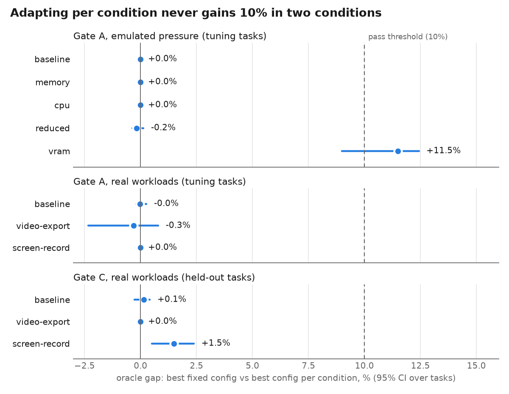
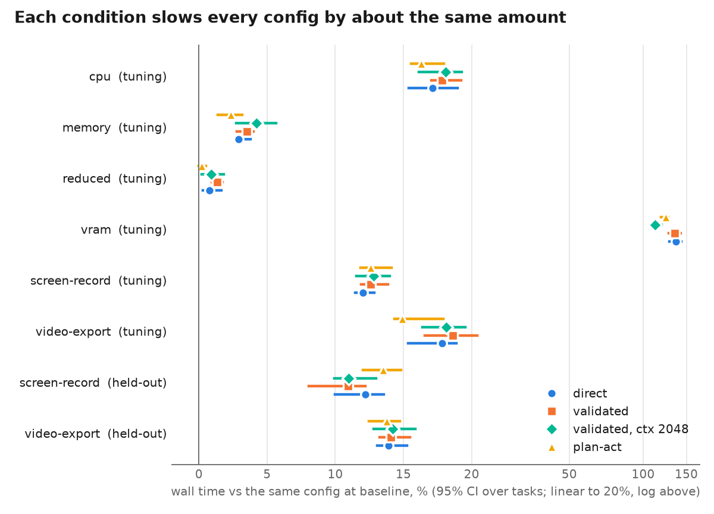

# Headroom

Headroom asks whether a local LLM agent on a laptop should change its configuration when the laptop gets busy. It compares the best fixed configuration with the best configuration chosen separately for each condition (the "oracle"). If the oracle is not clearly faster, adapting has nothing to win.

**Answer, for this laptop and config space: no.** Memory pressure, CPU contention, fewer threads, a video export and a screen recording each slow every configuration by about the same fraction. So the configuration that is best at baseline stays best, within a few percent, under every condition. The one exception is near-total VRAM exhaustion, where a smaller context is 11.5% faster. This held on 26 held-out task templates that no model saw until the final run.





The full record (design, pre-registered rules, every result and every failure inspected) is in [docs/PROJECT.md](docs/PROJECT.md). Figure data: [docs/figures/figures_data.csv](docs/figures/figures_data.csv).

## Results

All runs use qwen3.5:4b (Q4_K_M, thinking off, temperature 0, fixed seed) on one Windows 11 laptop: Ryzen 7 7840HS, 16 GB RAM, RTX 3050 6 GB laptop GPU. Each experiment is paired: the same tasks, repeats, seed and condition across configurations, in a seeded random order. The model is unloaded before every run, so no run reuses another's prompt cache. Every pass/fail rule was committed before its session ran.

| Test | Rule | Verdict |
|---|---|---|
| Emulated pressure: memory, CPU, threads, VRAM (20 tuning tasks, 1,200 runs) | `experiments/gate_a.toml` | FAIL: oracle gap ≥ 10% in 1 of 5 conditions (VRAM, +11.5%); 2 needed |
| Real workloads: ffmpeg video export, NVENC screen recording (26 tuning tasks, 936 runs) | `experiments/gate_a_real.toml` | FAIL: gap −0.3% to +0.0% |
| Held-out tasks: the real-workloads experiment on 26 frozen task templates (936 runs) | `experiments/gate_c.toml` | PASS: all 5 tuning-half findings replicate |

Other measured findings:

- **Configurations:** direct and validated (validation errors fed back for a retry) take the same time; the model almost never makes an invalid call. Plan-act is 42–48% slower. It solves one held-out task that the others fail and fails one they solve.
- **Context cap:** at 2048 tokens the agent is ~0.5% faster but fails long tasks with `context_exceeded`. The harness refuses oversized prompts rather than letting the backend silently truncate them.
- **Held-out success is lower:** 23/26 tasks pass on every repeat, against 26/26 on the tuning half. Two failures are shared by every configuration. In one, after three empty searches, the model writes a note with an invented date.
- **Contention runs both ways:** the agent slows a concurrent video export from 186 to 134 fps (−28%).
- **Second model:** qwen3.5:9b is 249% slower and passes fewer tasks, because only about half of it fits on the 6 GB GPU.
- **Second backend:** stock llama.cpp server b12777 gives the same results as Ollama 0.40.16, 6% faster, with about 1 GB less VRAM.
- **Not measured:** battery and energy. The test laptop's battery lasts under 45 minutes, so every run is on AC power, and no energy figure is reported or estimated.

## The benchmark

- **52 tasks** in three tool families (files, notes, calendar) and four tiers. Tier 4 covers long inputs over 2,048 tokens, chains of four or more state changes, and recovery from a tool error. The tasks are split by template into 26 tuning and 26 held-out tasks; the held-out half was frozen by sha256 before any model ran it.
- **Graders check the final environment state, never the model's wording.** Every grader is tested with a scripted correct and a scripted wrong solution, and note graders also with a negative case that has all the keywords but a wrong fact.
- **Configurations:** model × mode (direct, validated, plan_act, plan_act_verify) × context cap (2048, 8192) × retry limit. In every mode, invalid state-changing calls are rejected and never executed.
- **Conditions:**
  - emulated: memory ballast, CPU workers, thread limit, VRAM ballast;
  - real: background programs pinned by sha256 (ffmpeg libx264 export, ffmpeg NVENC 1080p60 recording).
- **Telemetry:** per-run wall time, prefill/decode split, peak RAM and VRAM, CPU, and the workload's own frame rate. A sensor that can't be read is recorded as unavailable, never estimated. Every run is also checked for a cold start, prompt-cache reuse and suspected sleep.

## Reproduce

Requires Python 3.11+, [uv](https://docs.astral.sh/uv/) and a local Ollama server with the pinned model. No paid APIs; everything runs offline.

```
uv run pytest                                   # offline tests (mocked backend)
uv run pytest -m live                           # against the local Ollama server
uv run headroom smoke                           # verify the pinned model, one measured call
uv run headroom run-experiment --experiment experiments/week3_real_workloads.toml
uv run headroom gate-a --experiment-id week3_real_workloads --rule experiments/gate_a_real.toml
uv run headroom gate-c                          # Gate C on the held-out session
uv run headroom report --experiment-id week2_conditions --all
uv run --group plots headroom figures           # regenerate docs/figures from results/
uv run headroom manifest                        # results/MANIFEST.json: sessions and sha256 per log
```

The raw run logs are in [results/](results/), one append-only JSONL file per experiment. They include every model call, tool call, grade, telemetry reading and machine provenance (OS, CPU, GPU, driver, power plan, git commit). `results/MANIFEST.json` lists each session and a sha256 for each file. Timing results depend on the hardware; success results should not.

## Layout

```
src/headroom/
  tasks/        task suite (tuning + frozen held-out), mock tools, state graders
  backends/     Ollama and llama.cpp server adapters
  conditions/   pressure injectors and real background workloads
  telemetry/    samplers, provenance; unavailable sensors are marked unavailable
  runner/       agent loop, paired runner, quiet-machine check, append-only logs, reports
  analysis/     Gate A, Gate C, figures
experiments/    experiment configs and pre-registered rules
results/        raw run logs and manifest
docs/           project record (PROJECT.md) and figures
```
